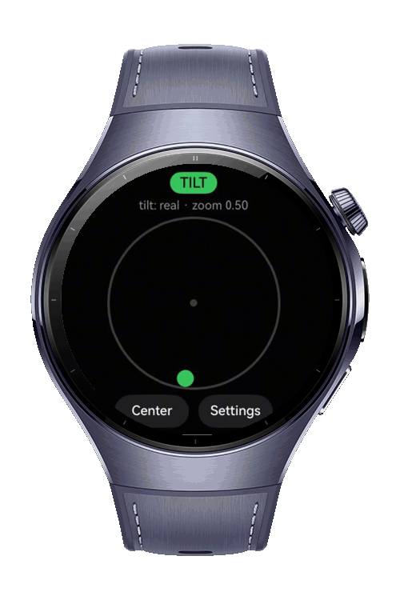
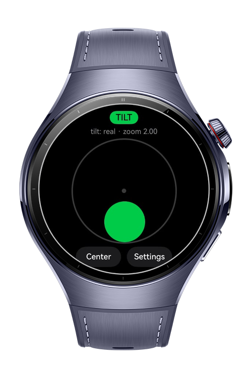

> **Note:** To access all shared projects, get information about environment setup, and view other guides, please visit [Explore-In-HMOS Index](https://github.com/Explore-In-HMOS/hmos-index).

# How to Handle Multimodal Gestures

This HarmonyOS wearable sample shows how to combine three inputs on one object: touch pan, digital crown rotation, and wrist tilt from the accelerometer. The app collects continuous gestures between frames and applies them one time per frame. A low-pass filter and a deadzone remove wrist jitter from the accelerometer. The app starts and stops the sensor and the frame callback with the page lifecycle.

# Preview

<div>
  
  
</div>

# Use Cases

- Collect continuous pan deltas and crown steps, and apply them one time per display frame
- Continue a pan with inertia after the finger leaves the screen
- Keep an object inside a round area with a polar clamp
- Smooth accelerometer data with a low-pass filter
- Remove wrist jitter with a radial deadzone that has no jump at its edge
- Give touch priority over tilt
- Stop the sensor and the frame callback when the page is not visible

# Technology

## Stack

- **Languages**: ArkTS, ArkUI
- **Frameworks**: HarmonyOS Stage Model
- **Tools**: DevEco Studio, Hvigor, Hypium
- **Libraries**:
	- `@kit.ArkUI` (`PanGesture`, `onDigitalCrown`, `Polyline`)
	- `@kit.ArkGraphics2D` (`displaySync`)
	- `@kit.SensorServiceKit` (`sensor`)
	- `@kit.ArkData` (`preferences`)
	- `@ohos/hypium` (unit tests)

## Required Permissions

- ohos.permission.ACCELEROMETER

## Inputs

| Input | Function | Source shown |
|---|---|---|
| Pan (one finger) | Moves the object | `TOUCH` |
| Digital crown | Changes the zoom of the object (0.5 to 2.0) | `CROWN` |
| Wrist tilt | Moves the object at a speed that increases with the tilt | `TILT` |
| No input | The object does not move | `IDLE` |

The source label at the top of the screen and the color of the object show the active source. You can use pan and the crown at the same time, because the crown changes the zoom and not the position.

## Gesture Accumulation

`GestureAccumulator` collects input between two frames:

- `PanGesture` gives the total offset since the start of the pan. The app adds only the new part of each event.
- Crown events add their rotation in degrees.
- A `displaySync` frame callback applies all collected input one time per frame. Thus, many events in one frame do not cause many UI updates, and no delta is lost.
- After a pan, the object continues at the release speed and slows down (inertia). The edge of the area stops it.
- The object cannot go out of the round area. The polar clamp keeps the direction and limits the distance from the center.

## Accelerometer Filter and Deadzone

Each accelerometer sample (50 Hz) goes through two steps:

1. **Low-pass filter**: `filtered = filtered + α × (raw − filtered)`. The default α is 0.2.
2. **Radial deadzone**: if the length of the x/y vector is less than the deadzone, the result is zero. If not, the vector keeps its direction and its length becomes `length − deadzone`. The default deadzone is 0.6 m/s².

Because the output starts at 0 at the edge of the deadzone, the object does not jump when the tilt leaves the deadzone. The chart in the settings panel shows the raw x value (gray) and the result after the filter and the deadzone (green). The dashed lines show the deadzone.

## Input Priority

`InputArbiter` gives touch the priority:

- While a finger is on the screen, tilt does not move the object.
- After the finger leaves the screen, tilt waits 300 ms.
- The crown does not block the other inputs.

## Lifecycle

| Event | Function |
|---|---|
| `onPageShow` | Starts the accelerometer and the `displaySync` frame callback |
| `onPageHide` (background, screen off) | Stops the accelerometer and the frame callback. Resets the collected input, the filter, and the input priority. |
| `aboutToDisappear` | Same as `onPageHide` |

The settings panel shows the number of active sensor subscriptions and the state of the frame callback.

## Settings

Tap **Settings** to open the panel. The app saves the deadzone, α, the sensitivity, and the inertia setting in preferences.

| Setting | Range | Default |
|---|---|---|
| Deadzone (m/s²) | 0.0 to 1.5 | 0.6 |
| Low-pass α | 0.05 to 1.0 | 0.2 |
| Touch sensitivity | 0.5 to 3.0 | 1.0 |
| Inertia after pan | on / off | on |

Tap **Center** to put the object back in the center.

## Test the Deadzone

1. Hold the watch still for 5 seconds with the default settings.
2. Make sure that the object does not move.
3. Open **Settings** and decrease the deadzone to 0.0.
4. Close the panel and hold the watch still again.
5. Make sure that the object now moves slowly because of small wrist movements.

## Simulated Tilt

The emulator does not have an accelerometer. Without an accelerometer, the app uses simulated tilt automatically. You can also set **Simulated tilt** to on.

- Move the **Tilt X** and **Tilt Y** sliders to tilt the simulated watch.
- **Add wrist jitter** adds random noise of ±0.4 m/s². With the default deadzone, this noise does not move the object.

# Directory Structure

```
entry/
|   src/
|       main/
│   module.json5
│
├───ets
│   ├───common
│   │       Constants.ets
│   │       Logger.ets
│   │
│   ├───entryability
│   │       EntryAbility.ets
│   │
│   ├───input
│   │       AccelFilter.ets
│   │       Deadzone.ets
│   │       GestureAccumulator.ets
│   │       InputArbiter.ets
│   │       InputLifecycle.ets
│   │       InputSettings.ets
│   │       Vec2.ets
│   │
│   └───pages
│           Index.ets
│
|       test/
│           Filters.test.ets
│           Gestures.test.ets
│           List.test.ets

```

# Constraints and Restrictions

## Supported Device

- Huawei Watch 5

## Notes

- The app requires HarmonyOS 6.0.1 (API 21) or later. The digital crown API (`onDigitalCrown`) requires API 18 or later.
- Crown events go to the focused component and then to its parents. A container can get the focus only through a focusable child, so the arena (a `Stack` with shapes only) cannot get the focus. Thus, the crown handler is on the page root. The focus goes to a button, and the crown event goes up from the button to the root.
- The emulator accelerometer can show gravity on the y axis. Then the object moves to the bottom of the area. On the emulator, set **Simulated tilt** to on.
- `uinput` and `uitest` cannot send crown events. To test the crown on the emulator, use the crown control of the emulator.
- The tilt direction uses the device axes: x points to the right and y points up. If the object moves in the wrong direction on a device, change the signs in `onAccel` in `Index.ets`.

# License

**How to Handle Multimodal Gestures** is distributed under the terms of the MIT License. See the [LICENSE](LICENSE) for more information.
